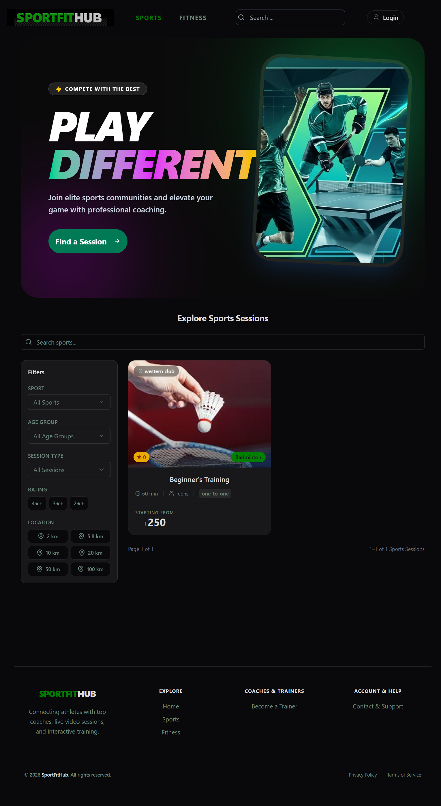

# SportFit Hub – Sports & Fitness Booking Platform

## Live Demo
[Visit SportFitHub](https://sportfithub.com)

## Project Overview
SportFit Hub is a full-stack sports and fitness booking platform that connects users with trainers and allows them to explore and book sports and fitness training sessions.

This project was independently designed and developed as a full-stack application.

## Key Features

- Sports and fitness session browsing and booking
- User and trainer management
- Real-time messaging using Socket.IO
- Video calling using WebRTC
- Online payment integration using Stripe (Test Mode)
- Stripe webhook signature verification
- Progressive Web Application (PWA)
- Responsive user interface

## Technology Stack

**Frontend**
- React.js
- TypeScript
- Tailwind CSS

**Backend**
- Node.js
- Express.js
- TypeScript

**Database**
- MongoDB

**Real-Time Communication**
- Socket.IO
- WebRTC

**Payment Integration**
- Stripe

**Deployment & Tools**
- AWS EC2
- Amazon S3
- Doppler
- Git and GitHub
- 

## Application Screenshots

<h3>Homepage</h3>

<h3>Sports Listing</h3>

## Deployment

- Frontend: Amazon S3
- Backend: AWS EC2

## Developer

Independently developed by Asmabi Shajeer.
